

 

 


Results-driven <b>Full-Stack Software Engineer</b> who ships AI-powered products end to end. 
I work across <b>MERN</b>, <b>Next.js</b> and <b>Python</b>, with a focus on <b>RAG pipelines</b>, <b>multi-agent systems</b> 
and production-minded delivery: Docker, CI/CD and automated testing.

<a href="https://alashamel.github.io/"><b>✦ Explore the interactive portfolio →</b></a>

 

  
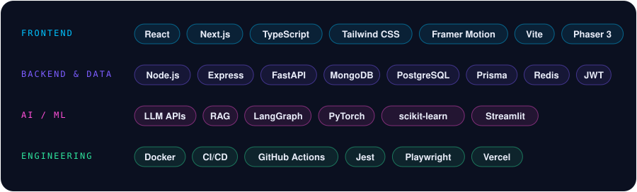
  

  

<a href="https://github.com/Alaashamel/AI-doc-Chatbot">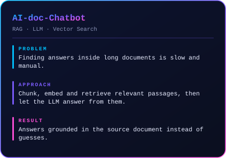</a>
<a href="https://github.com/Alaashamel/ai-engineering-orchestrator"></a>
<a href="https://github.com/Alaashamel/AI-Web-Operating-System">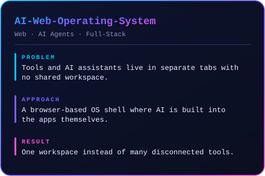</a>
<a href="https://github.com/Alaashamel/resudy-ai"></a>
<a href="https://github.com/Alaashamel/coderag"></a>
<a href="https://github.com/Alaashamel/pixel-kingdom-survival-rpg">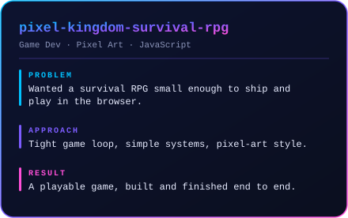</a>

 

  
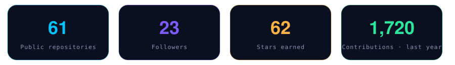
  
  
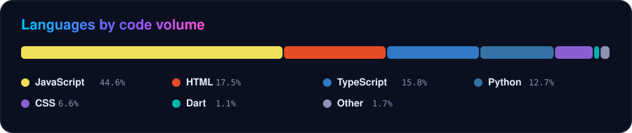
 
📊 Auto-updated daily from the GitHub API
 

 

  

 
Thanks for stopping by · stars are always appreciated ⭐

