 

---

## 👨‍💻 About

Results-driven **Full-Stack Software Engineer** from Giza, Egypt. I design and ship products across the whole stack, with a strong focus on **AI & LLM applications**: retrieval-augmented generation, multi-agent orchestration, and production-minded delivery (Docker, CI/CD, automated tests).

> 🚀 **See everything in motion → [alashamel.github.io/Alaashamel](https://alashamel.github.io/Alaashamel/)**

## 🛠️ Tech Stack

**Frontend** 

**Backend & Data** 

**AI / ML** 
 &nbsp;`LLM APIs` `RAG` `LangGraph` `Streamlit`

**DevOps & Quality** 

## ⭐ Featured Projects

<table>
<tr>
<td width="50%" valign="top">

### 🧠 [AI-doc-Chatbot](https://github.com/Alaashamel/AI-doc-Chatbot)
Enterprise **RAG** document-chat platform with multiple LLM providers, Prisma + PostgreSQL, Docker, CI/CD, Jest & Playwright.

`Next.js` `TypeScript` `RAG` `Docker`

</td>
<td width="50%" valign="top">

### 🤖 [ai-engineering-orchestrator](https://github.com/Alaashamel/ai-engineering-orchestrator)
**Multi-agent** system that turns software ideas into complete, tested projects, orchestrated with LangGraph.

`Python` `LangGraph` `Agents`

</td>
</tr>
<tr>
<td valign="top">

### 🖥️ [AI-Web-Operating-System](https://github.com/Alaashamel/AI-Web-Operating-System)
A full desktop OS in the browser: draggable windows, glassmorphism UI, AI assistant and lock screen.

`React` `TypeScript` `Framer Motion`

</td>
<td valign="top">

### 📄 [resudy-ai](https://github.com/Alaashamel/resudy-ai)
AI resume platform: ATS score, job match, cover letters and interview prep, powered by the **Claude API**.

`Next.js` `Supabase` `Claude`

</td>
</tr>
<tr>
<td valign="top">

### 🔎 [coderag](https://github.com/Alaashamel/coderag)
Q&A assistant for codebases that answers with **cited source locations**.

`Python` `RAG` `TF-IDF`

</td>
<td valign="top">

### 🎮 [pixel-kingdom-survival-rpg](https://github.com/Alaashamel/pixel-kingdom-survival-rpg)
Survival RPG with a 4000×4000 procedural world, enemy AI and touch controls.

`React` `Phaser 3`

</td>
</tr>
</table>

## 📊 GitHub Activity

 

## 📫 Let's Connect

I'm open to full-stack and AI engineering opportunities and collaborations.

⚡ Thanks for stopping by, and stars are always appreciated ⭐

